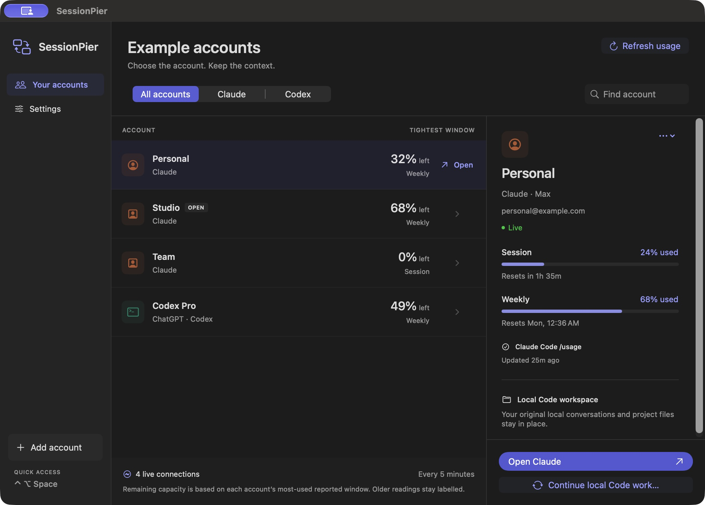

# SessionPier

**All your AI accounts. One place to keep working.**

SessionPier is a native macOS companion for people with multiple Claude subscriptions and ChatGPT accounts used through Codex. See remaining capacity, switch to the right account, and continue local Claude Code work without hunting through separate launchers.

The first public release is a beta. macOS comes first; other platforms are on the roadmap.



[View the compact menu bar panel](docs/images/menu-bar.png). Screenshots show bundled example data.

## What it does

- **Menu bar access.** Check accounts in a compact panel; open the full workspace for details. Control–Option–Space opens quick access.
- **Automatic usage.** Refresh every 1, 5 or 15 minutes through official provider clients. Readings retain their source and timestamp; missing limits stay unknown, and failures keep clearly labelled older data.
- **Claude account switching.** Separate Desktop profiles preserve their saved logins. Open or focus the intended account without replacing the signed Claude application.
- **Local conversation continuity.** Opt into shared local Claude Code history, then refresh the destination account after stopping active turns. Shared accounts keep Remote Control blocked.
- **Multiple Codex accounts.** Each added account gets a separate CLI home. Open a project with that identity without changing the Codex desktop app's login.
- **Optional capacity alerts.** Get notified at 80%, 95% and 100% used, and when capacity returns.
- **Native preferences.** Hide email addresses, choose whether to show a Dock icon, and enable launch at login.

SessionPier never routes prompts, automatically switches a running request, or sends a model message to measure usage.

## Requirements

- macOS 13 or later. The downloadable beta is built for Apple silicon; Intel can build from source, but has not been verified in this release.
- [Claude Desktop](https://claude.ai/download) for Claude account switching.
- [Claude Code](https://code.claude.com/docs/en/setup) for live Claude usage.
- [Codex CLI](https://developers.openai.com/codex/cli) for Codex accounts and limits.
- An eligible subscription, connected through each provider's official sign-in flow.

**Scope:** the ChatGPT integration reads **Codex limits** on a ChatGPT plan. It does not claim to show every ChatGPT web-model quota or switch ChatGPT Desktop accounts. Claude usage currently requires a matching Desktop identity and a native CLI login.

## Install

Download the Apple silicon app from [Releases](https://github.com/rishwajeet/sessionpier/releases), unzip it, and move **SessionPier.app** to your Applications folder. The app includes its own Python runtime; running the download does not require Python or uv.

The beta is ad-hoc signed and is **not Apple-notarized**. macOS may block a downloaded build. You can inspect and build the source locally using the steps below. Developer ID signing and notarization are release follow-ups.

### Build from source

Install Xcode Command Line Tools and [uv](https://docs.astral.sh/uv/getting-started/installation/), then:

```sh
git clone https://github.com/rishwajeet/sessionpier.git
cd sessionpier
uv run python -m unittest discover -s tests -v
uv run python install.py
```

The installer builds the native SwiftUI/AppKit interface, includes a relocatable Python 3.13 runtime, validates the bundle, and installs `~/Applications/SessionPier.app`. It also installs `claude-profile` and `cla` in `~/.local/bin`. When replacing a previous managed app, it saves a verified ZIP under `build/app-archives.noindex/` first. Unrelated applications are not removed.

To package without changing the installed app:

```sh
uv run python install.py --package build/SessionPier-macOS-arm64.zip
```

## First use

1. Import the Claude Desktop account already on your Mac, or add an account with a clear label.
2. Sign in to its Desktop profile and open the Code tab once. To avoid callback confusion, Desktop sign-in explicitly asks you to close other Claude windows first; finish their active work before continuing.
3. Choose **Connect live usage** and finish the official Claude Code sign-in for the same account and workspace. SessionPier checks the account and organization identities before accepting usage. If the native client asks for a folder confirmation, choose **Finish setup**.
4. For another ChatGPT subscription, add a **ChatGPT · Codex** account and connect the official Codex CLI.
5. Close the main window to keep the companion in the menu bar. Quitting the app stops background refresh.

The existing native Codex CLI account is detected automatically when Codex is installed.

## Continue local Claude Code work

History sharing is an explicit choice for newly added accounts. When enabled, local CLI transcript directories point to their original files; Desktop sidebar records are reconciled into the destination account. Credentials and account-scoped connector state are excluded.

Finish or stop the source turn, stop any work in the destination, then choose **Continue local Code work…**. SessionPier refreshes and reopens only the destination. Select the same conversation in **Code → Local**. The source window and its login can remain saved.

This is local conversation continuity. Resuming a conversation sends its context to the provider under the selected subscription, and the provider's account policies still apply. It is not a transfer of cloud chat ownership. See [architecture and data](docs/ARCHITECTURE.md).

## Usage and privacy

Claude usage comes from the official CLI's built-in `/usage` screen in safe mode, without hooks, tools, plugins or a model prompt. Codex usage comes from the documented `account/rateLimits/read` app-server method. SessionPier does not extract browser cookies or copy provider OAuth tokens. The official clients own sign-in and credential storage.

The app stores account labels, preferences, normalized usage readings and a bounded seven-day reading history locally. It has no telemetry service or hosted backend. Usage probes communicate with the providers through their native clients. The UI shows the most-used **reported** quota window; this is not a promise that an account can make any particular model request.

For compatibility with the original local utility, data remains under `~/Library/Application Support/Claude Profiles/`. Existing accounts and transcripts are preserved during the rename.

## Development

The interface is SwiftUI hosted by AppKit. The backend uses the Python standard library. Tests use synthetic account data and temporary directories. Choose **SessionPier → Preview with example accounts** to inspect a fixture without connecting real accounts; choose it again to return to live data.

- [Product roadmap](docs/PRODUCT-PLAN.md)
- [Architecture and data](docs/ARCHITECTURE.md)
- [Release verification](docs/VERIFICATION.md)
- [Contributing](CONTRIBUTING.md)
- [Security](SECURITY.md)

Independent project; not affiliated with Anthropic or OpenAI. [MIT license](LICENSE); bundled dependencies retain their [own licenses](THIRD-PARTY-NOTICES.md).
